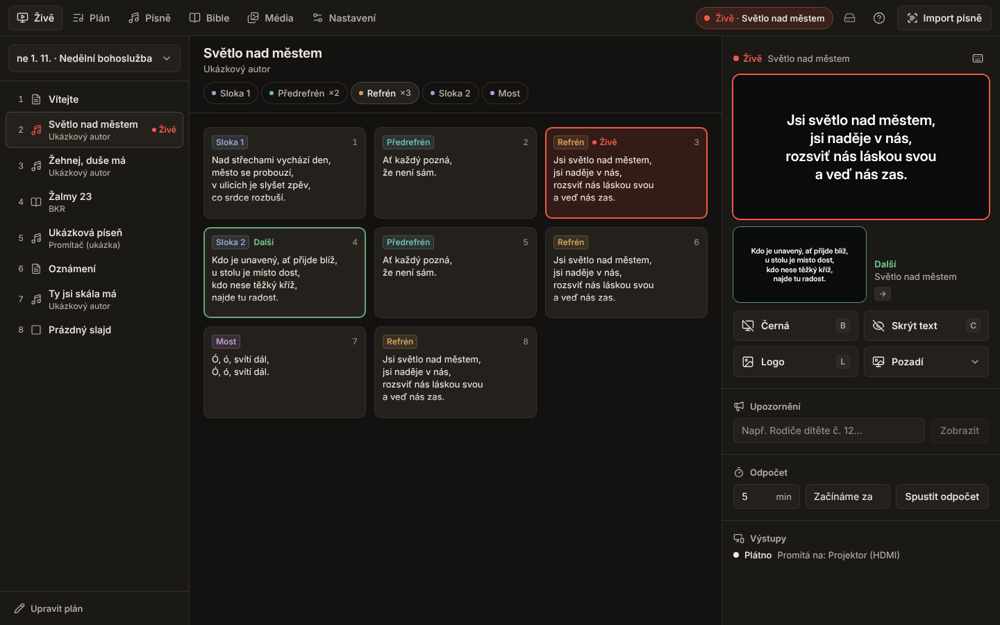

# Promítač

Promítací aplikace pro církve (macOS + Windows): knihovna písní v ChordPro, plán bohoslužby, živé promítání
na druhý monitor, motivy, Bible (kralická + KJV), média, sdílená knihovna sboru přes Supabase a offline
**asistent importu písní** (text, fotka ze zpěvníku, PDF, Word) – bez placené AI a beze změny textu.

## Pro uživatele

**Stáhnout:** [nejnovější verze pro Windows a Mac](https://github.com/Murtag-7/promitac/releases/latest)

- [Instalace na Mac a Windows](docs/INSTALL.md)
- [Návod pro promítače](docs/NAVOD.md)
- [Sdílená knihovna přes Supabase](docs/SUPABASE_SETUP.md)
- [Stav projektu, co je ověřené](docs/STATUS.md) · [Rozhodnutí](docs/DECISIONS.md)
- Screenshoty: [docs/screenshots](docs/screenshots)

## Pro vývojáře

Electron 44 + electron-vite + React 19 + TypeScript (strict) + Tailwind 4. Čistá logika je v `src/core`
(bez DOM/Node/Electronu), main proces v `src/main`, UI v `src/renderer` (běží i v prohlížeči s mockovaným API).

| Příkaz | Co dělá |
|---|---|
| `npm ci` | instalace závislostí |
| `npm run dev` | aplikace v Electronu s hot reloadem |
| `npm run dev:web` | UI v prohlížeči (mock API) na http://localhost:5199 |
| `npm run typecheck` / `npm run lint` | TypeScript (core, node, web) / ESLint + Prettier |
| `npm test` | unit testy (Vitest) |
| `npm run test:ocr` | přesnost OCR na vzorových fotkách |
| `npm run test:e2e` | UI testy v prohlížeči (Playwright) |
| `npm run test:electron` | end-to-end testy Electronu (pod `xvfb-run`) |
| `bash scripts/test-migrations.sh` | Supabase migrace + RLS na lokálním PostgreSQL |
| `npm run screenshots` | přegeneruje `docs/screenshots` |
| `npm run dist:mac` / `npm run dist:win` | lokální build `.dmg` / `.exe` |

Buildy pro macOS a Windows dělá GitHub Actions workflow **Build desktop apps** (ručně, na tag `v*` a u PR do `main`).

Plán implementace: [docs/plans/2026-10-27-promitac-implementation.md](docs/plans/2026-10-27-promitac-implementation.md) ·
Zadání: [docs/SPEC.md](docs/SPEC.md) · Instrukce pro Claude: [CLAUDE.md](CLAUDE.md)
