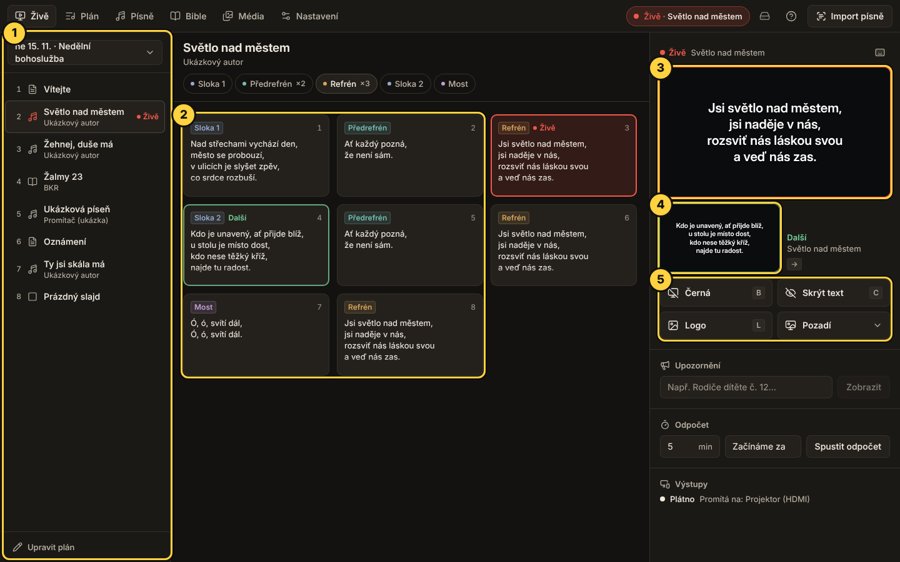

# Jak na Promítač

Návod na pět minut. Stačí ho přečíst jednou, zbytek se naučíte za pochodu. V aplikaci ho kdykoli otevřete
klávesou **F1**.

## Tři věci, které musíte vědět

1. **Kliknete na slajd = hned je na plátně.**
2. **Červený rámeček = to je teď na plátně. Zelený = to přijde další.**
3. **Když si nevíte rady, zmáčkněte B.** Plátno zčerná a v klidu najdete, co potřebujete. **Esc** vrátí
   obraz zpět.

## Před bohoslužbou

1. **Zapojte projektor.** Obraz na něm musí být „rozšířená plocha", ne kopie obrazovky:
   - Windows: klávesy **Win + P** → **Rozšířit**.
   - Mac: **Nastavení systému → Monitory** → projektor nastavte jako rozšířenou plochu, ne zrcadlení.
2. **Otevřete Promítač.** Projektor najde sám. Pro jistotu: **Nastavení → Výstupy → Test obrazu** – na
   plátně se na chvíli objeví nápis.
3. **Připravte plán.** Záložka **Plán** → **Nový plán** → vyberte datum → **Nový plán**. Pak tlačítky
   **Píseň**, **Bible** a **Text / oznámení** přidejte, co se bude promítat. Pořadí změníte přetažením
   za úchyt vlevo.
4. Klikněte **Promítat tento plán**. Otevře se záložka **Živě**.

Tip: minulý plán zkopírujete přes **⋯ → Duplikovat na datum**.

## Během bohoslužby: záložka Živě

1. **Plán** (vlevo) – klik na položku ukáže její slajdy. Na plátně se zatím nic nemění.
2. **Slajdy** (uprostřed) – klik na slajd ho pošle na plátno. Nad nimi jsou zkratky (Sloka 1, Refrén…) pro případ,
   že kapela změní pořadí.
3. **Teď na plátně** (vpravo nahoře) – červený rámeček.
4. **Další** (pod tím) – zelený rámeček. Kliknutím ho pošlete na plátno.
5. **Rychlá tlačítka** (vpravo) – Černá, Skrýt text, Logo, Pozadí.

Pod tlačítky můžete napsat **Upozornění** (pás dole na plátně, třeba „Rodiče dítěte č. 12…") nebo spustit
**Odpočet** před začátkem.

**Klávesy:**

| Co chcete | Zmáčkněte |
|---|---|
| Další slajd | **→** nebo **mezerník** (klikr funguje sám) |
| Předchozí slajd | **←** |
| Černé plátno | **B** |
| Schovat text, pozadí zůstane | **C** |
| Vrátit obraz zpět | **Esc** |
| Refrén / sloka 2 | **R** / **2** |

Na konci písně šipka pokračuje další položkou plánu.

## Nová píseň

1. Vpravo nahoře klikněte **Import písně**.
2. Vložte text písně (klidně s akordy nad řádky) a klikněte **Převést**. Nebo do okna přetáhněte fotku ze
   zpěvníku, PDF nebo Word.
3. Zkontrolujte název. U fotek klikněte **Upravit** a projděte zvýrazněná slova – tam si program nebyl jistý.
4. Klikněte **Přidat do knihovny**. Píseň teď najdete v záložce **Písně** a můžete ji přidat do plánu.

Překlep v písni opravíte v záložce **Písně** přímo v textu. Ukládá se samo.

## Bible

Záložka **Bible** → napište odkaz, třeba `J 3,16`, `Ž 23` nebo `1K 13,4-7` → **Přidat do plánu**.

## Když se něco pokazí

- **Na plátně je špatný slajd** → zmáčkněte **B**, najděte správný slajd a klikněte na něj.
- **Na projektoru nic není** → zkontrolujte kabel a **Win + P → Rozšířit** (na Macu Monitory), pak
  **Nastavení → Výstupy → Test obrazu**. Po znovupřipojení kabelu se obraz vrátí sám.
- **Klikr ani klávesy nereagují** → klikněte jednou do okna Promítače a zkuste to znovu.
- **Program zamrzl** → zavřete ho a otevřete znovu. Nic se neztratí, všechno se ukládá průběžně.

K promítání není potřeba internet.

---

Všechno ostatní (motivy, média, zálohy, sdílení písní se sborem) je v [podrobném návodu](NAVOD-PODROBNY.md).
